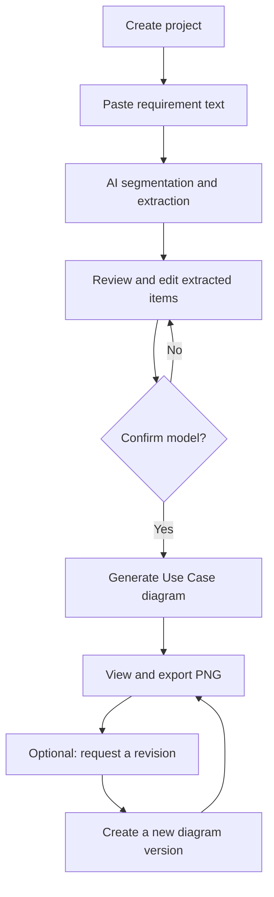
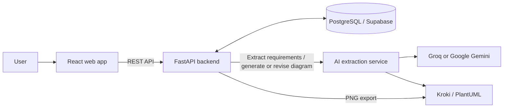

# Software Design Diagram Generator (SDDG)

SDDG is a web application that turns natural-language software requirements into structured requirements and software-design models, with the goal of generating diagrams from those models. The project combines an interactive requirements workflow, an AI extraction service, and a diagram-rendering backend.

> **Current implementation status:** the end-to-end AI-backed path currently generates **Use Case diagrams only**. Other diagram types are shown as planned options in the interface; they are not yet available for generation.

## Table of Contents

- [What It Does Today](#what-it-does-today)
- [Workflow](#workflow)
- [Architecture](#architecture)
- [Technology Stack](#technology-stack)
- [Repository Layout](#repository-layout)
- [Getting Started](#getting-started)
  - [Option A: Run the Frontend Demo](#option-a-run-the-frontend-demo)
  - [Option B: Run the Integrated Application](#option-b-run-the-integrated-application)
- [Configuration Reference](#configuration-reference)
- [Running Tests](#running-tests)
- [Known Limitations](#known-limitations)
- [Tentative Roadmap](#tentative-roadmap)
- [Project Documentation](#project-documentation)

## What It Does Today

- **Manage projects:** create and reopen projects in a user workspace.
- **Submit requirements:** type or paste requirement text, user stories, or SRS excerpts. File upload and direct document parsing are not implemented yet.
- **Extract a structured model:** split submitted text into atomic requirement statements and identify actors, entities, processes, data flows, data stores, interactions, and relationships.
- **Review before generation:** inspect extracted modelling items, edit item names and descriptions, and explicitly confirm the model before generating a diagram.
- **Generate a Use Case diagram:** derive a structured Use Case specification from the confirmed actors and processes, produce PlantUML source, and render the diagram through Kroki.
- **Revise with natural-language feedback:** request changes to a generated diagram. Each successful revision creates a new version, preserving the earlier version and the revision instruction.
- **Inspect and export:** view the diagram with pan/zoom controls and export it as a PNG image.
- **Track asynchronous work:** show progress and errors for extraction and diagram generation jobs.
- **Gate AI processing with consent:** the integrated backend requires the user to agree to the current AI-processing policy before submitting requirements.

## Workflow

1. **Create a project.** Give the requirements workspace a name.
2. **Submit requirement text.** Paste functional or non-functional requirements, user stories, or SRS text.
3. **Extract and segment.** The AI service separates the input into requirement statements and extracts modelling elements with source references.
4. **Review and edit.** Correct extracted item names or descriptions and confirm the model.
5. **Generate a diagram.** Generate a Use Case diagram from the confirmed model.
6. **Iterate.** Describe a change in plain language. SDDG creates a new diagram version rather than overwriting the previous version.
7. **Export.** Download the selected version as PNG.



## Architecture

SDDG is organised as three application components plus a diagram renderer and PostgreSQL database.



- **Web app (`apps/web`)** — React, TypeScript, Vite, React Router, TanStack Query, and Tailwind CSS. It contains the project workflow, requirement review screens, diagram viewer, and a mock API mode for frontend development.
- **Backend API (`apps/api`)** — FastAPI service for authentication checks, AI-consent enforcement, project persistence, requirement/item review, job status, diagram versioning, and export. PostgreSQL stores projects, statements, extracted items, jobs, and diagrams.
- **AI extraction service (`services/ai-extraction`)** — a separate FastAPI service using LangGraph and LangChain. Its extraction graph splits requirements, extracts model categories in dependent/parallel stages, and merges the results. It also creates and revises Use Case specifications and PlantUML source.
- **Database** — PostgreSQL; the supplied configuration is designed to work with Supabase Postgres and Supabase Auth. A development-only token bypass is available for local integration work.
- **Diagram rendering (`infra/kroki-compose.yml`)** — a self-hosted Kroki deployment used to render PlantUML. The current workflow uses PlantUML for Use Case diagrams.

## Technology Stack

| Area | Main technologies |
| --- | --- |
| Frontend | React, TypeScript, Vite, React Router, TanStack Query, Tailwind CSS |
| Backend API | Python, FastAPI, psycopg, PostgreSQL |
| AI extraction | LangGraph, LangChain, Pydantic, Groq or Google Gemini |
| Diagram generation | PlantUML source, Kroki renderer |
| Authentication | Supabase Auth when configured; mock auth for local/demo use |
| Testing | Vitest, Testing Library, pytest, FastAPI integration test |

## Repository Layout

```text
SDDG-main/
├── apps/
│   ├── api/                  # FastAPI backend, database access, API schemas
│   └── web/                  # React + TypeScript frontend
├── services/
│   └── ai-extraction/        # LangGraph extraction pipeline and Use Case generation
├── infra/
│   └── kroki-compose.yml     # Local Kroki and Mermaid containers
├── docs/
│   ├── Designs/              # Technology-stack/design material
│   ├── Requirements/         # Requirements and product backlog
│   └── research/             # Research and elicitation documents
└── README.md
```

## Getting Started

Choose **Option A** for a quick frontend demonstration. Choose **Option B** to run the API, real AI extraction, database persistence, and diagram rendering together.

### Prerequisites

For the frontend demo, install **Node.js and npm**.

For the integrated application, you will also need:

- Python 3.10+ (use a version supported by the installed dependencies)
- A PostgreSQL database; the example configuration is written for Supabase Postgres
- An API key for the configured LLM provider (Groq or Google Gemini)
- Docker Engine / Docker Desktop with the Compose plugin, for Kroki
- `psql` or another way to execute the database schema against PostgreSQL

Commands below use a Bash-compatible shell. On Windows, use WSL or replace `cp` with PowerShell's `Copy-Item`.

### Option A: Run the Frontend Demo

This mode uses the Mock Service Worker (MSW) API handlers and mock authentication. It is useful for exploring the interface without a database, LLM key, backend API, or Kroki container. Data and behaviour are simulated; it does **not** run the real extraction pipeline.

```bash
cd apps/web
npm install
cp .env.example .env.local
```

In `apps/web/.env.local`, set:

```dotenv
VITE_USE_MOCKS=true
VITE_MOCK_COLD_START=false
```

Then start the development server:

```bash
npm run dev
```

Open the URL printed by Vite (usually `http://localhost:5173`). The mock authentication flow includes a development email-verification shortcut; it does not send real verification emails.

To demonstrate the UI's simulated server-waking banner, set `VITE_MOCK_COLD_START=true`.

### Option B: Run the Integrated Application

The integrated setup runs four processes/services: PostgreSQL, the AI service, the backend API, and the frontend. Kroki runs in Docker. Start each long-running process in a separate terminal and keep its terminal open.

#### 1. Configure environment files

From the repository root:

```bash
cp apps/api/.env.example apps/api/.env
cp services/ai-extraction/.env.example services/ai-extraction/.env
cp apps/web/.env.example apps/web/.env.local
```

Edit the copied files before starting the services. Do not commit `.env` or `.env.local` files, and never put LLM secrets in frontend variables.

#### 2. Configure the database and apply the schema

Set `DATABASE_URL` in `apps/api/.env` to your PostgreSQL connection string. The included example shows the expected Supabase connection-string format.

Apply the schema once to the target database. For example, with `psql` and a shell that can load the `.env` file:

```bash
set -a
source apps/api/.env
set +a
psql "$DATABASE_URL" -f apps/api/schema.sql
```

The API needs the tables in `apps/api/schema.sql` before it can operate. The API startup code opens the connection pool; do not rely on startup to apply the schema automatically.

#### 3. Configure and start the AI extraction service

In `services/ai-extraction/.env`, choose a provider and add its key. For Groq:

```dotenv
LLM_PROVIDER=groq
GROQ_API_KEY=your_groq_api_key
GROQ_MODEL=openai/gpt-oss-120b
KROKI_BASE_URL=http://localhost:8080
```

Alternatively, configure Google Gemini:

```dotenv
LLM_PROVIDER=gemini
GOOGLE_API_KEY=your_google_api_key
GEMINI_MODEL=gemini-2.0-flash
KROKI_BASE_URL=http://localhost:8080
```

Install the service dependencies and run it from its own directory so its `.env` file is loaded:

```bash
cd services/ai-extraction
python -m venv .venv
source .venv/bin/activate
pip install -r requirements.txt
uvicorn app.main:app --reload --host 127.0.0.1 --port 8001
```

The service is available at `http://localhost:8001`; its health endpoint is `http://localhost:8001/api/v1/health` and interactive API documentation is at `http://localhost:8001/docs`.

#### 4. Start Kroki

From the repository root, run:

```bash
docker compose -f infra/kroki-compose.yml up -d
```

Kroki is exposed on `http://localhost:8080`, matching the supplied environment examples. The current Use Case diagram flow requires Kroki to be reachable for rendering and PNG export.

#### 5. Configure and start the backend API

In `apps/api/.env`, check the following settings:

```dotenv
DATABASE_URL=your_postgresql_connection_string
DEV_AUTH_BYPASS=true
AI_SERVICE_URL=http://127.0.0.1:8001/api/v1
KROKI_URL=http://127.0.0.1:8080
CORS_ORIGINS=http://localhost:5173
```

`DEV_AUTH_BYPASS=true` is for local development only. It permits the frontend's mock-token authentication to reach the backend; do not enable this bypass in a deployed environment. With real Supabase Auth, configure `SUPABASE_URL` and `SUPABASE_PUBLISHABLE_KEY`, set `DEV_AUTH_BYPASS=false`, and configure the matching Supabase values in the frontend.

Start the API:

```bash
cd apps/api
python -m venv .venv
source .venv/bin/activate
pip install -r requirements.txt
uvicorn main:app --reload --host 127.0.0.1 --port 8000
```

The backend health endpoint is `http://localhost:8000/health`; interactive API documentation is at `http://localhost:8000/docs`.

#### 6. Start the frontend against the backend

In `apps/web/.env.local`, set:

```dotenv
VITE_API_URL=http://localhost:8000/api/v1
VITE_USE_MOCKS=false
VITE_SUPABASE_URL=
VITE_SUPABASE_ANON_KEY=
```

Leaving the Supabase frontend values empty enables mock authentication. This works for local integration only when the backend has `DEV_AUTH_BYPASS=true`. For a real Supabase login, fill in the URL and public/anonymous key and disable the backend bypass as described above.

Then, in another terminal:

```bash
cd apps/web
npm install
npm run dev
```

Open the URL printed by Vite (usually `http://localhost:5173`). Submit requirements only after the AI service, database, and backend API are running and the appropriate AI provider key is configured.

## Configuration Reference

### Backend API (`apps/api/.env`)

| Variable | Purpose |
| --- | --- |
| `DATABASE_URL` | PostgreSQL connection string; required |
| `DEV_AUTH_BYPASS` | Allows mock tokens in local development; keep disabled in deployments |
| `SUPABASE_URL` | Supabase Auth endpoint when using real authentication |
| `SUPABASE_PUBLISHABLE_KEY` | Public/publishable Supabase key used to validate tokens |
| `AI_SERVICE_URL` | Base URL for the AI service API, including `/api/v1` |
| `KROKI_URL` | Base URL for diagram PNG rendering |
| `AI_POLICY_VERSION` | Version of the AI-processing consent policy enforced by the API |
| `CORS_ORIGINS` | Comma-separated frontend origins allowed by the API |

### AI service (`services/ai-extraction/.env`)

| Variable | Purpose |
| --- | --- |
| `LLM_PROVIDER` | Selects `groq` or `gemini` |
| `GROQ_API_KEY` / `GOOGLE_API_KEY` | Server-side credentials for the selected provider |
| `GROQ_MODEL` / `GEMINI_MODEL` | Model used by the selected provider |
| `MAX_RETRIES` | Retry limit for AI extraction calls |
| `REQUEST_TIMEOUT_SECONDS` | LLM request timeout |
| `KROKI_BASE_URL` | Kroki endpoint used for PlantUML rendering |
| `LOG_LEVEL` | Service log verbosity |

### Frontend (`apps/web/.env.local`)

| Variable | Purpose |
| --- | --- |
| `VITE_API_URL` | Backend API base URL |
| `VITE_USE_MOCKS` | `true` enables MSW handlers; `false` sends requests to the backend |
| `VITE_MOCK_COLD_START` | Enables a simulated initial 503 response in mock mode |
| `VITE_SUPABASE_URL` / `VITE_SUPABASE_ANON_KEY` | Enables Supabase Auth when both are supplied |

## Running Tests

### Frontend

```bash
cd apps/web
npm test
npm run typecheck
npm run build
```

### AI extraction service

```bash
cd services/ai-extraction
source .venv/bin/activate
pytest
```

### Backend integration test

`apps/api/tests_integration.py` exercises the backend-to-AI contract with deterministic stubbed AI/render responses, but it still requires a working PostgreSQL database and a valid `DATABASE_URL`. It creates and removes test records for a temporary user.

```bash
cd apps/api
source .venv/bin/activate
python tests_integration.py
```

## Known Limitations

- Only **Use Case diagrams** are enabled end to end. Class, Activity, Sequence, DFD, and Component options are not implemented yet; State diagram support is also not wired into the current diagram-type model.
- Input is plain text pasted into the application. PDF/DOCX/SRS file upload, file parsing, and richer input-source management are not implemented.
- Review currently supports editing extracted item names and descriptions. It is not yet a full model editor for changing all relationships and properties.
- Diagram editing is driven by natural-language instructions and produces a new version. Direct drag-and-drop element repositioning and a full visual style editor are not implemented.
- PNG is the supported export format. SVG, PlantUML source download, PDF, and other export formats are not exposed as user export options.
- Extraction and generation run as in-process FastAPI background tasks; a durable distributed job queue and production-scale worker management are not included.
- The mock frontend mode is for demos and development only. It should not be treated as real AI output, persistent server storage, or production authentication.

## Tentative Roadmap

The following is a working direction, not a committed release schedule.

### 1. Input and extraction quality

- Support additional input methods, including document upload and structured requirement sources.
- Strengthen validation for empty, malformed, unsupported, or excessively large input.
- Improve requirement segmentation, source traceability, and review/edit/confirm flows.
- Surface ambiguous, conflicting, incomplete, or potentially invalid requirements and help users resolve them before generation.

### 2. Broader diagram coverage

- Add generation for DFD, Class, Activity, Sequence, Component, and State diagrams.
- Define and validate the mapping from extracted model elements to each diagram type.
- Improve diagram-specific checks and explain missing information or assumptions before rendering.

### 3. Diagram authoring and feedback

- Add direct diagram-canvas editing, including moving and repositioning elements.
- Expand feedback-based regeneration and make changes easier to review or compare across versions.
- Add visual customization before export, such as layout and style controls.

### 4. Validation, export, and navigation

- Validate generated diagrams for structural consistency and unresolved references before marking a generation complete.
- Add export options such as SVG, source text, and PDF where suitable.
- Add search and filtering for projects, requirements, modelling items, and diagram versions.
- Improve completion notifications and recovery guidance for failed or partial jobs.

### 5. Security and operational readiness

- Review authentication, authorization, secrets handling, data retention, and AI-consent flows before deployment.
- Add stronger rate limiting, auditability, and operational monitoring.
- Move long-running work to durable queue/workers and improve retries, cancellation, and recovery.
- Evaluate database/query performance and service scaling for larger projects.

## Project Documentation

The repository includes additional project material:

- [`docs/Requirements/Requirements_SDDG.pdf`](docs/Requirements/Requirements_SDDG.pdf) — requirements specification.
- [`docs/Requirements/SDDG_Product_Backlog.pdf`](docs/Requirements/SDDG_Product_Backlog.pdf) — product backlog.
- [`docs/Designs/SDDG Technology Stack.pdf`](docs/Designs/SDDG%20Technology%20Stack.pdf) — technology-stack reference.
- [`docs/research/Concept_Poster.pdf`](docs/research/Concept_Poster.pdf) — project concept poster.
- [`docs/research/Stackholder_Ellicitation.pdf`](docs/research/Stackholder_Ellicitation.pdf) — stakeholder elicitation material.

---

SDDG is an evolving project. Treat the current implementation and the tentative roadmap as separate: roadmap items describe intended direction, not features that are already available.
